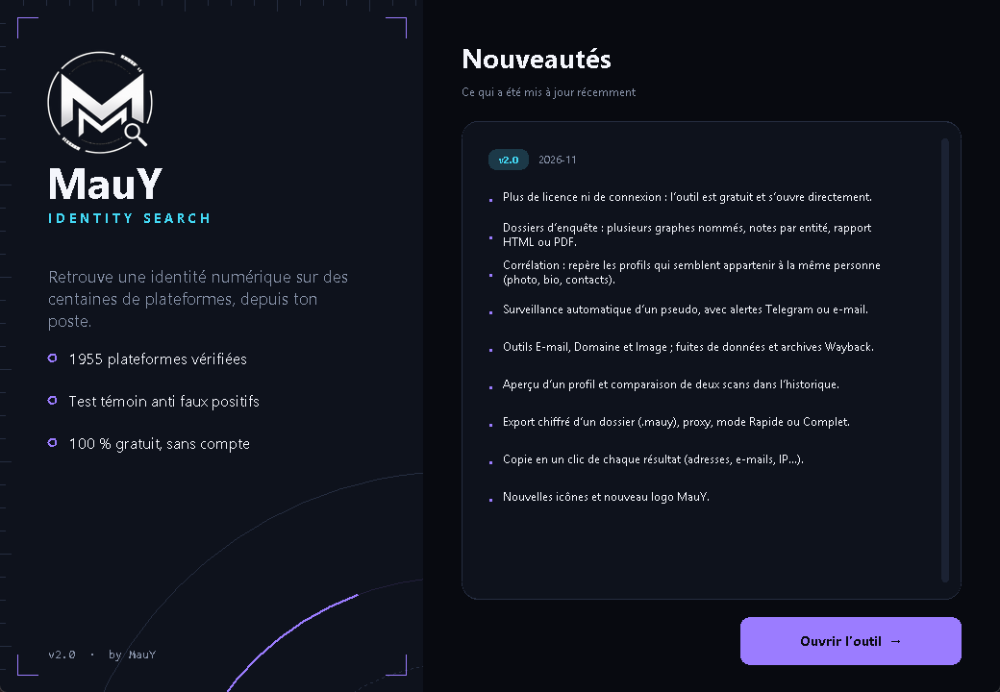
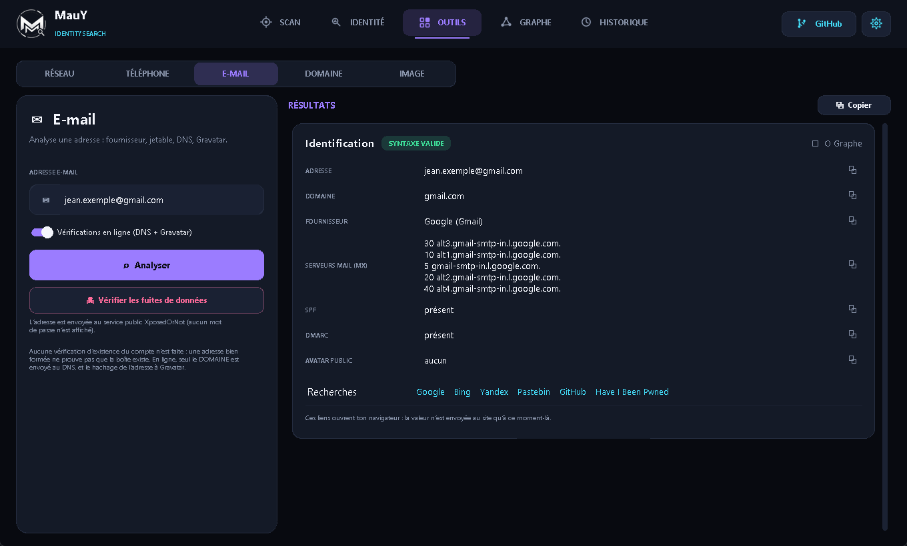
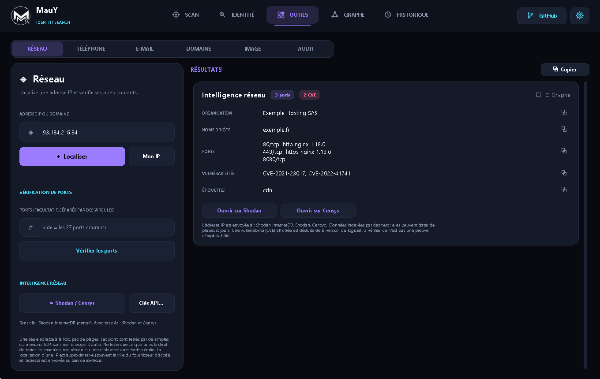
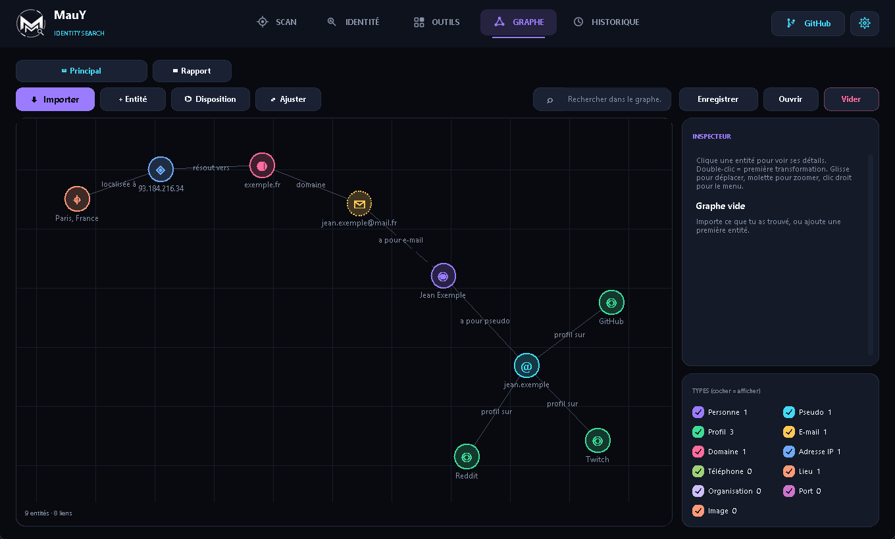
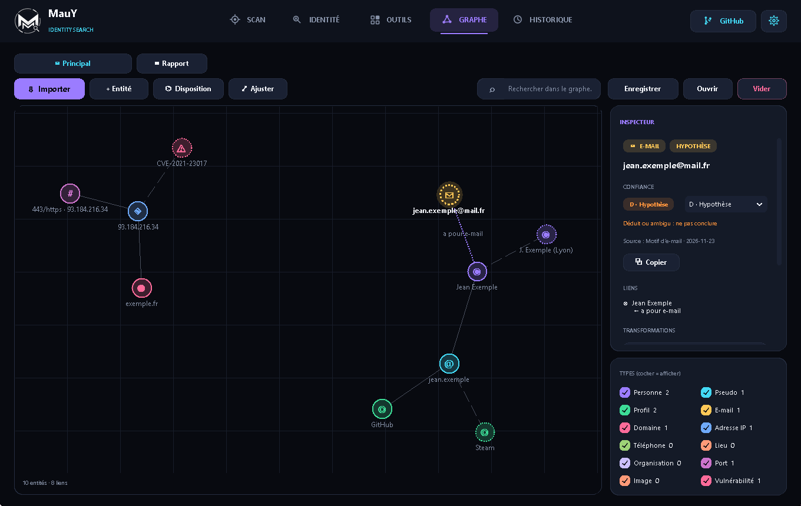

<div align="center">

# Identity Search

**Retrouve une identité numérique sur près de 2 000 plateformes, depuis ton PC.**
100 % gratuit · sans compte · sans clé · sans installation

*by MauY*

</div>



## Ce que fait l'outil

Identity Search regroupe dans une seule application Windows les recherches d'OSINT (renseignement en sources ouvertes) les plus utiles : trouver où un pseudo existe, analyser une adresse e-mail, un domaine, une IP ou un numéro de téléphone, puis relier tout ça dans un graphe d'enquête.

Tout se passe sur ton ordinateur. Aucune donnée n'est envoyée à un serveur MauY.

## Fonctionnalités

### Scan de pseudo
- **1 955 sites** vérifiés, dont **589** en mode *Rapide* (environ 25 secondes).
- **Test témoin** anti faux positifs : chaque site est comparé à un pseudo inventé pour éviter les « trouvé » à tort.
- Aperçu d'un profil (photo, titre, description), copie en un clic, comparaison de deux scans.
- **Corrélation** : repère les profils qui semblent appartenir à la même personne (photo, bio, contacts communs).


### Identité
Génère des variantes de noms, de pseudos et d'adresses e-mail à partir d'un prénom et d'un nom, puis les scanne en lot.

### Outils
| Outil | Ce qu'il donne |
|---|---|
| **Réseau** | Localisation d'une IP, nom inverse, scan de ports, **Shodan InternetDB** (gratuit), **Shodan** et **Censys** avec ta propre clé (ports, services, CVE) |
| **Téléphone** | Validité, pays, région, opérateur, type de ligne |
| **E-mail** | Fournisseur, jetable, serveurs mail, SPF/DMARC, Gravatar, fuites de données |
| **Domaine** | DNS, propriétaire (RDAP), sous-domaines, archives |
| **Image** | Métadonnées EXIF, position GPS, recherche d'image inversée |



**Intelligence réseau** : depuis l'outil Réseau, interroge Shodan InternetDB (gratuit) ou, avec tes propres clés, Shodan et Censys. Tu obtiens les ports, les services, les noms d'hôte et les vulnérabilités connues (CVE) d'une IP publique.



### Graphe d'enquête
Un graphe interactif à la Maltego : chaque résultat peut être ajouté d'une case à cocher, les hypothèses sont en pointillés, et un double-clic lance la transformation suivante.
- **Dossiers d'enquête** : plusieurs graphes nommés, avec notes par entité.
- **Niveaux de confiance A à F** sur chaque entité (confirmé, probable, indice, hypothèse, conflit, obsolète), avec source et date.
- **Missions** : objectif, cible, contexte et périmètre de chaque enquête, repris dans le rapport.
- Liens de **contradiction** entre deux entités.
- **Rapport** HTML ou PDF structuré : mission, faits, indices, hypothèses, conflits, sources, recommandations.
- **Export chiffré** `.mauy` protégé par mot de passe.



Chaque entité porte un **niveau de confiance** (A à F), une source et une date, modifiables dans l'inspecteur. Deux entités peuvent être marquées comme contradictoires.



### Audit d'empreinte
Dans OUTILS > AUDIT : saisis ton pseudo, tes e-mails et ton domaine. L'outil cherche tes comptes publics, tes fuites de données et les failles de ton domaine (SPF, DMARC, sous-domaines), puis calcule un **score d'exposition** et un **plan d'action**. Un clic crée un dossier d'enquête prêt pour le rapport.


### Et aussi
- **Surveillance** automatique d'un pseudo, avec alertes Telegram ou e-mail.
- Mode **Rapide** ou **Complet**, support de **proxy** (HTTP / SOCKS5).
- 4 thèmes, français et anglais.
- Journal d'activité local, désactivable.

## Installation

1. Va dans l'onglet **Releases** et télécharge `Identity Search.exe`.
2. Double-clique dessus. Rien d'autre à installer.

> **Windows SmartScreen** : au premier lancement, Windows peut afficher « Windows a protégé votre ordinateur ». C'est normal pour un programme non signé. Clique sur **Informations complémentaires**, puis **Exécuter quand même**.

### Vérifier le fichier (facultatif)

Compare l'empreinte SHA-256 du fichier téléchargé avec celle-ci :

```
28268899807BB414C2F57140DB84A337BC5E1D8E1D7F97D76ED0A8377D0B9556
```

```powershell
Get-FileHash "Identity Search.exe" -Algorithm SHA256
```

## Confidentialité

- Tout est calculé sur ton PC ; l'historique et les dossiers restent dans `%APPDATA%\MauY`.
- L'outil n'interroge que des **sources publiques**. Il n'accède à aucun compte privé.
- Les recherches envoient la valeur saisie aux sites concernés (c'est le principe d'un scan), et au service de fuites de données uniquement quand tu cliques sur le bouton dédié.

## Utilisation responsable

Identity Search est fait pour des usages légitimes : vérifier ta propre empreinte numérique, enquêter dans un cadre professionnel ou autorisé, retrouver un compte. N'utilise pas l'outil pour traquer, harceler ou usurper l'identité de quelqu'un. Un résultat est un **indice**, pas une preuve : un homonyme n'est pas la même personne. Tu restes responsable de ton usage et du respect de la loi (RGPD notamment).

## Contact

GitHub : [MauY-w](https://github.com/MauY-w)

---

<div align="center"><sub>© MauY</sub></div>
